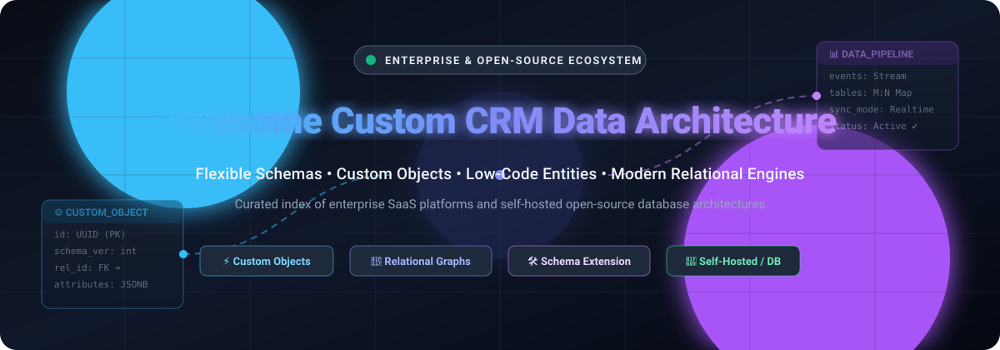
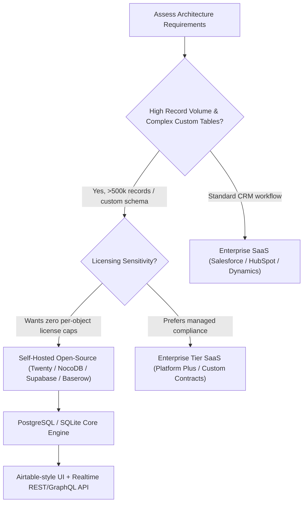

# ⚡ Awesome Custom CRM Data Architecture 🏗️

  <strong>A curated index of enterprise SaaS platforms, flexible data model engines, and self-hosted open-source relational databases for building modern custom CRM systems.</strong>

  
  
  
  
  
  

  <em>Mastering custom objects, many-to-many associations, event streams, schema evolution, and self-hosted data sovereignty.</em>

---

## 🧭 Table of Contents
- [📌 Overview & Architecture Concepts](#-overview--architecture-concepts)
- [📈 Sector Overview & Market Dynamics](#-sector-overview--market-dynamics)
- [🏢 SaaS & Hosted Platforms](#-saashosted-platforms)
- [💻 Open-Source GitHub Projects](#-open-source-github-projects)
- [🏗️ Architectural Trade-Offs: SaaS vs Self-Hosted](#-architectural-trade-offs-saas-vs-self-hosted)
- [🤝 How to Contribute](#-how-to-contribute)
- [💖 Support](#-support)
- [⭐ Star History](#-star-history)
- [⚖️ Disclaimer](#-disclaimer)

---

## 📌 Overview & Architecture Concepts

Extending CRM systems beyond out-of-the-box contact and deal tables has become a critical requirement for scaling modern businesses. A **Custom CRM Data Architecture** empowers engineering and revenue operations teams to:
- 🧩 **Define Custom Objects & Entities:** Model domain-specific entities (e.g., Subscriptions, Deliveries, Wearable Devices, Properties, Patient Records).
- 🔗 **Configure Relational Topologies:** Create foreign keys, lookup fields, self-referencing nodes, and Many-to-Many (`M:N`) junction records with custom association attributes.
- ⚡ **Automate Schema Evolution:** Alter schemas, add validated constraints, set field-level RBAC (Role-Based Access Control), and expose REST/GraphQL APIs dynamically without code deployments.
- 🛡️ **Ensure Data Sovereignty:** Choose between managed enterprise clouds with compliance guarantees or self-hosted SQL/PostgreSQL backends to dodge punitive per-object licensing fees.

---

## 📈 Sector Overview & Market Dynamics

The global CRM and extensible customer data platforms sector is valued at approximately **$113B–$126B** (projected to exceed $160B–$300B+ into the 2030s). The market exhibits a distinct dual structure: it is **moderately concentrated at the top**—dominated by enterprise giants like Microsoft, Oracle, and Salesforce (which alone commands ~20% market share)—yet **highly fragmented across the broader ecosystem**, where hundreds of mid-market, SMB, and no-code/relational database tools compete for specialized workflows.

---

## 🏢 SaaS/Hosted Platforms

| Product | Company Scale (Valuation / Market Cap / Revenue) | Description | Pricing (Starting) | Free Tier / Trial Limits |
|---------|--------------------------------------------------|-------------|-------------------|--------------------------|
| **[Microsoft Dynamics 365](https://dynamics.microsoft.com/)** | **~$3.88 Trillion** Market Cap (~$346.5B TTM Revenue) | Enterprise CRM/ERP suite with 98 customizable standard entities (out of 271 total) plus unlimited custom entities. Solution-managed properties control packaging, customization states, and Power Apps Dataverse relational schemas. | **$65/user/month** (Sales Professional, annual commitment) | **30-day free trial**: full feature access to workflows, pipelines, and reporting without credit card; no permanent free tier |
| **[Oracle CX Sales Custom Objects](https://www.oracle.com/)** | **~$390 Billion** Market Cap (~$67.4B FY Revenue) | Enterprise CRM with Application Composer for creating custom top-level and child objects. Supports custom attributes, relationships, and REST API exposure (requires sandbox publish). Custom Object Administration role required. | **$65/user/month** (Professional Edition list entry, annual billing) | **30-day free trial** available via sales consultation / Oracle Cloud free account with $300 universal cloud credits; no permanent free tier |
| **[Salesforce Custom Objects](https://www.salesforce.com/)** | **~$178 Billion** Market Cap (~$36B Annual Revenue) | Flagship enterprise CRM with custom object limits tiered by edition. Platform Starter includes 10 custom objects; Platform Plus includes 110. Supports master-detail relationships, lookup filters, formula fields, validation rules, and page layouts. | Platform Starter: **$25/user/month** (10 custom objects); Platform Plus: **$100/user/month** (110 custom objects) | **30-day free trial** with full platform capabilities; permanently free Developer Edition available (limited to 2 users, 5 MB data storage, non-production use) |
| **[ServiceNow Custom Tables](https://www.servicenow.com/)** | **~$160 Billion** Market Cap (~$11B–$13B Annual Revenue) | Enterprise workflow platform with custom table entitlements. Non-exempt tables consume subscription usage rights and must be mapped to App Engine products. Base and Extended table inheritance supported natively. | **$70/user/month** (ITSM standard fulfiller entry) / **$75/creator/month** (App Engine Starter list benchmark) | **Permanently free Personal Developer Instance (PDI)**: 1 active instance, hibernates when idle, reclaimed after 10 days of inactivity; no commercial production free tier |
| **[Zoho CRM Custom Modules](https://www.zoho.com/crm/)** | **~$12.5 Billion** Valuation (~$1.4B–$1.5B Annual Revenue) | Multi-tier CRM with custom module limits: Standard: 10, Professional: 25, Enterprise: 200, Ultimate: 500. Modules support unique layouts, related lists, and automated workflow orchestration. | Standard: **$14/user/month** (10 modules, annual); Professional: **$23/user/month** (25 modules); Enterprise: **$40/user/month** (200 modules) | **Free Edition**: up to 3 users, 5,000 records, 1 GB storage (custom modules/fields restricted to paid tiers); **15-day free trial** for paid plans with full feature access and no credit card |
| **[HubSpot Custom Objects](https://www.hubspot.com/)** | **~$11 Billion** Market Cap (~$3.4B Annual Revenue) | Inbound and revenue CRM platform with custom object schema API (`/crm/v3/schemas`). Define custom properties, searchable fields, and bi-directional associations with standard Deals, Contacts, and Companies. | **$150/seat/month** (Sales Hub Enterprise, required for custom objects; typically requires minimum seats and $3,500 onboarding) | **14-day free trial** for Enterprise features (no credit card required); forever-free plan limited to standard CRM tools with 2 users (excludes custom objects) |
| **[Airtable](https://airtable.com/)** | **~$2.25 Billion** Acquisition Valuation (~$480M ARR) | Relational database-spreadsheet hybrid with linked records, lookup fields, rollups, and multiple views (Grid, Kanban, Gallery, Gantt). Enterprise features include Interface Designer and sync integrations. | Team: **$20/seat/month** (billed annually, up to 50,000 records/base) | **Free forever plan**: up to 1,000 records per base, 1 GB attachment storage, up to 5 editors |
| **[Coda](https://coda.io/)** | **~$1.4 Billion** Valuation (~$35M Annual Revenue) | All-in-one document and database workspace featuring formula-driven tables, interactive buttons, automations, and external data packs. Only Doc Makers are billed; Readers/Editors participate free. | Pro: **$10/month per Doc Maker** (annual); Team: **$30/month per Doc Maker** | **Free forever plan**: unlimited unshared docs, shared docs capped at 50 objects and 1,000 rows per doc, 1 GB doc storage, 7-day version history |
| **[Quickbase (Pave)](https://www.quickbase.com/)** | **~$1.0 Billion** PE Valuation (~$200M Annual Revenue) | Enterprise low-code platform for operational reporting and complex relational databases. Connects disparate systems with governance, automated pipelines, and custom schema extensions. | Team: **$35/user/month** (annual commitment) / Launch: **$99/month** | **Pave Free Tier**: 1 app, 1 builder, up to 3 users, 100 one-time step credits; **30-day free trial** of Business edition with full feature access |
| **[SmartSuite](https://www.smartsuite.com/)** | **~$150 Million** Valuation (~$5M–$10M ARR) | Modern collaborative work management suite with deeply customizable relational solutions, field-level permissions, linked record lookups, and 40+ specialized field data types. | Team: **$15/seat/month** (annual, 3-user minimum, up to 5,000 records per solution) | **14-day free trial**: full Professional features with 5,000 records/solution, no credit card required; no permanent free tier |

---

## 💻 Open-Source GitHub Projects

*Sorted in descending order by GitHub stargazers count.*

| Project | Stars_Badge | Description | Architecture Highlights |
|---------|------------|-------------|-------------------------|
| **[Supabase](https://github.com/supabase/supabase)** |  | Open-source Firebase alternative built on PostgreSQL. Provides an instant relational backend, auto-generated REST/GraphQL APIs, Realtime WebSockets, Row Level Security (RLS), and database web studio. | PostgreSQL-native, auto-generated schemas, Auth, Edge Functions, pgvector support. |
| **[NocoDB](https://github.com/nocodb/nocodb)** |  | Open-source smart spreadsheet that connects directly to production SQL databases (PostgreSQL, MySQL, SQLite, SQL Server) and turns them into collaborative no-code relational apps with REST APIs. | Connects to existing schemas without data migration; supports views, formula columns, and unlimited viewer/editor tiers. |
| **[PocketBase](https://github.com/pocketbase/pocketbase)** |  | Lightweight open-source backend in 1 single Go binary with embedded SQLite, real-time subscriptions, schema management UI, file storage, and extensible Go/JS hooks. | Single binary zero-dependency deployment, embedded SQLite with WAL mode, built-in admin dashboard. |
| **[Twenty](https://github.com/twentyhq/twenty)** |  | The modern open-source CRM alternative to Salesforce. Built from the ground up for total schema flexibility, allowing teams to create custom objects, fields, relations, and workflows natively in code or via UI. | Full custom object support, GraphQL API, PostgreSQL + NestJS + React, self-hostable via Docker. |
| **[Appwrite](https://github.com/appwrite/appwrite)** |  | Secure end-to-end backend server packaged as Docker microservices. Provides relational database collections, document-level security, asynchronous event triggers, and cloud functions. | Modular Docker architecture, JSON document collections with indexing, multi-language SDKs. |
| **[Directus](https://github.com/directus/directus)** |  | Real-time API and App data engine that wraps any SQL database without proprietary lock-in. Creates dynamic REST and GraphQL endpoints reflecting your tables, relations, and roles. | Pure schema mirror (zero vendor data lock-in), granular RBAC, Node.js + Vue.js, supports PostgreSQL/MySQL/SQLite/MSSQL. |
| **[Teable](https://github.com/teableio/teable)** |  | Super-fast, real-time open-source Airtable alternative built natively on PostgreSQL. Scales to millions of records with pure SQL capability, formula fields, and instant spreadsheet UI. | PostgreSQL-native storage, sub-second query performance on million+ rows, real-time collaboration via WebSockets. |
| **[APITable](https://github.com/apitable/apitable)** |  | Visual collaborative database platform with spreadsheet-like data entry, bi-directional table links, automated forms, and developer-friendly REST APIs. | High-concurrency relational interface, multi-view presentation, embeddable API widgets. |
| **[Grist](https://github.com/gristlabs/grist-core)** |  | Relational spreadsheet-database hybrid powered by Python formulas and standard SQLite. Delivers full spreadsheet ergonomics backed by strict relational integrity and access rules. | Python formula engine, SQLite underlying engine, granular column- and row-level access control. |
| **[Rowy](https://github.com/rowyio/rowy)** |  | Open-source low-code platform for Firestore and Google Cloud. Manage data with a spreadsheet UI while writing custom Node.js/TypeScript Cloud Functions directly from the browser. | Firestore-native, serverless execution, real-time sync, zero DevOps setup. |
| **[Baserow](https://github.com/baserow/baserow)** |  | Open-source no-code database built with Django and PostgreSQL. Unlimited rows on self-hosted instances, rich field types, webhooks, formula calculations, and role management. | Django + Nuxt/Vue + PostgreSQL, GDPR/HIPAA ready, modular plugin architecture, self-hostable via Docker. |
| **[Mathesar](https://github.com/mathesar-foundation/mathesar)** |  | Open-source web UI for PostgreSQL that lets users interact directly with relational data models, schemas, and tables without needing SQL knowledge. | Direct PostgreSQL management, zero proprietary abstraction layers, respects native PostgreSQL constraints and types. |

---

## 🏗️ Architectural Trade-Offs: SaaS vs Self-Hosted

- **SaaS Enterprise Clouds:** Best when you need out-of-the-box omnichannel communication, built-in marketing automation, ready-made Salesforce/HubSpot partner ecosystems, and enterprise SLAs. Drawbacks include steep per-object tiering and rapid seat-cost escalation.
- **Self-Hosted Relational Engines:** Best for developers and data architects demanding predictable infrastructure expenditure, zero per-object or per-row licensing caps, complete data sovereignty, and direct SQL access for warehouse ELT pipelines.

---

## 🤝 How to Contribute

We welcome additions, corrections, and updates from the community!

1. 🍴 **Fork the repository.**
2. 🌿 **Create a feature branch:** `git checkout -b feat/add-my-platform`.
3. 📝 **Add or update entries in `README.md`:** Ensure descriptions remain factual, objective, and include verified pricing, free tier details, and official documentation links.
4. 🚀 **Submit a Pull Request** with a brief summary of why the tool fits Custom CRM Data Architecture.

Please follow our [Code of Conduct](https://github.com/ishandutta2007/Awesome-Awesome-Awesome) and contribution guidelines.

---

## 💖 Support

Thank you for exploring and building with **Awesome Custom CRM Data Architecture**! If you found this repository insightful or time-saving for your data modeling decisions, please consider supporting the project:

- ⭐ **Star this repository** to help others discover it on GitHub.
- 🍴 **Fork and share** with your data architecture and RevOps colleagues.
- ☕ **Sponsor the maintainer / Buy a coffee:** Check out our [GitHub Sponsors Dashboard](https://github.com/sponsors/ishandutta2007) to help support continuous curation, benchmark updates, and new developer tools.

---

## ⭐ Star History

---

## ⚖️ Disclaimer

- This is a **community-curated** list — not exhaustive and not a commercial endorsement.
- Custom CRM data architectures govern business-critical records and relationships; always enforce role-based access, validation rules, automated backups, and audit trails to prevent data integrity issues.
- **Custom object limits vary significantly by platform and tier.** Salesforce caps Platform Starter at **10 objects**; Zoho ranges from **10 to 500** depending on edition; ServiceNow custom tables consume **subscription entitlements** and require careful license mapping. HubSpot custom objects require the Enterprise tier. Open-source solutions eliminate per-object limits but require infrastructure provisioning and maintenance. Always validate schema design against your actual data model complexity before committing.

---

  <strong>Made with ❤️ for CRM administrators, data architects, operations teams, and developers building custom data infrastructure.</strong>

